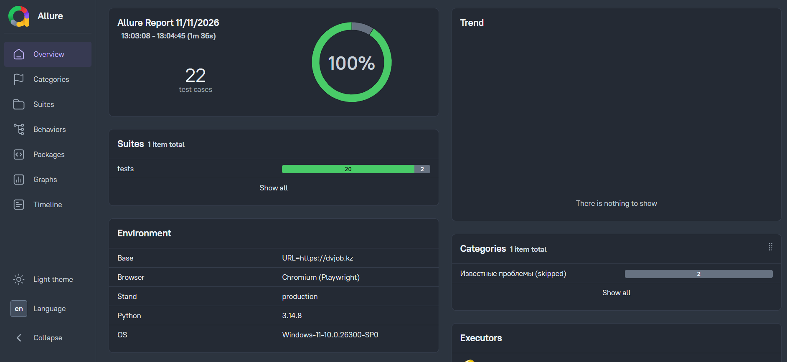
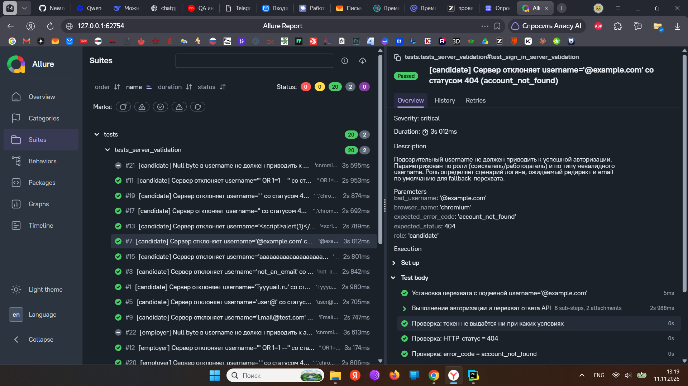
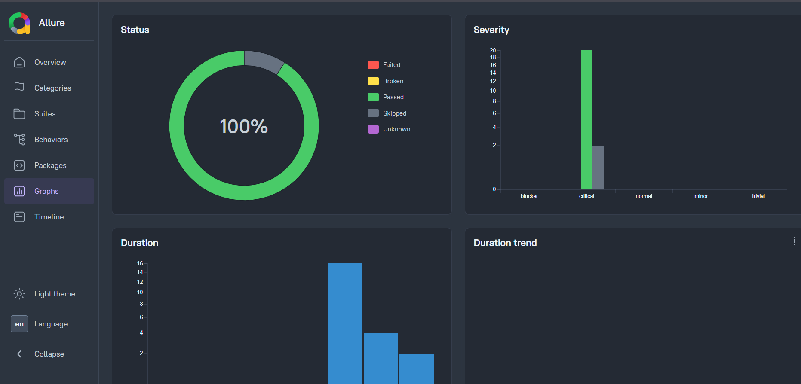

# DVJob UI Tests

Автоматизированный фреймворк UI-тестирования и серверной валидации для международной платформы по поиску работы (https://dvjob.kz).
Навигация, поиск, авторизация двух ролей и серверная валидация логина, включая негативные и security-сценарии.


## Чем интересен проект

- **Page Object Model** с локаторами (`get_by_role`, `get_by_placeholder`) —
  устойчивыми к изменениям вёрстки.
- **Перехват и подмена сетевых запросов** (`page.route` + `expect_response`):
  фронт отправляет валидный e-mail, перехват подменяет поле `username` — так
  проверяется именно серверная валидация, а не клиентская.
- **Security-кейсы в параметризации**: SQL-инъекция, XSS, омоглифы,
  10 000 символов, пустые значения — единый сценарий × две роли.
- **Развёрнутые Allure-отчёты**: `environment.properties`, `executor.json`
  с инкрементным buildOrder для вкладки Trends, свои категории дефектов,
  скриншот + HTML + URL страницы автоматически прикладываются к упавшему тесту.
- **Ретраи на гидратацию Nuxt/Vue** -  клики по ролям и выпадающим меню повторяются
  до подтверждения (`aria-expanded`, активный класс) вместо слепых `sleep`.
- **Единая конфигурация** (`config.py` + `.env`) -  учетные данные не
  хардкодятся и не попадают в репозиторий.

##  Скриншоты Allure-отчёта

Ниже приведены примеры сгенерированных Allure-отчётов с результатами прогона.

**Обзор (Overview):**
Наглядно видно 100% прохождение (20 passed, 2 skipped), а также раздел Environment с информацией о стенде и браузере.


**Детализация тестов (Suites):**
Древовидная структура с шагами, приложенными параметрами (payload'ы, ожидаемые статусы) и вложениями.


**Графики (Graphs):**
Распределение тестов по статусам, уровням критичности (Severity) и длительности.


##  Технологии

- **Python 3.12+**
- **Playwright** — браузерная автоматизация (Chromium)
- **pytest** — тестовый runner
- **pytest-playwright** — интеграция Playwright с pytest
- **pytest-rerunfailures** — один ретрай для flaky-тестов (`--reruns 1`)
- **Allure Framework** — HTML-отчётность с шагами, скриншотами и аттачами
- **python-dotenv** — хранение учётных данных в `.env`

## Покрытие (64 кейса)

| Модуль | Кейсов | Что проверяется |
| --- | ---: | --- |
| `test_main_page.py` | 13 | заголовок, логотип, переключение языков, поиск вакансий/резюме, промо, чат поддержки |
| `test_upper_menu.py` | 6 | меню «Соискателям» и «Работодателям» -  каталоги, советы, формы, авторизация для консультаций |
| `test_footer.py` | 21 | ссылки, телефон/e-mail, адрес, копирайт, соцсети, отсутствие пустых ссылок в футере |
| `test_auth.py` | 4 | вход соискателя и работодателя (позитив/негатив) |
| `test_server_validation.py` | 22 | серверная валидация `username` (10 значений × 2 роли) |

##  Структура проекта

conftest.py
    # фикстуры: home, footer, auth, validation_page
    # автоскрин при падении теста
    # генерация environment.properties / executor.json / categories.json (Allure)
pytest.ini
    # --alluredir, --reruns 1
requirements.txt
.env.example
    # скопировать в .env и заполнить креды

pages/                  # Page Object Layer
    base_page.py        # родительский класс всех страниц
    home_page.py        # главная -  лого, переключение языка, поиск, верхнее меню
    footer_page.py      # футер -  контакты, ссылки, соцсети
    auth_page.py        # роли + форма входа + клиентская валидация
    server_validation_page.py
                        # перехват POST /v1/accounts/sign-in, подмена username
                        

tests/
    test_main_page.py
    test_footer.py
    test_upper_menu.py
    test_auth.py
    test_server_validation.py
                        # security-валидация: 2 роли — соискатель и работодатель

docs/allure/            # скрины Allure-отчёта для README

##  Быстрый старт

### 1. Клонирование и установка зависимостей

```bash
git clone <repo-url>
cd <project>

python -m venv .venv
source .venv/bin/activate          # Windows: .venv\Scripts\activate
pip install -r requirements.txt
playwright install chromium
```

### 2. Подготовка учётных данных

```bash
cp .env.example .env
# Откройте .env и впишите валидные логины/пароли тестовых аккаунтов dvjob.kz:
#   CandidateLogin, CandidatePassword       — тестовый аккаунт соискателя
#   EmployerLogin, EmployerPassword          — тестовый аккаунт работодателя
```

### 3. Запуск тестов

```bash
# Весь набор
pytest

# Один модуль
pytest tests/test_footer.py

# Один тест с подробным выводом
pytest tests/test_footer.py::test_footer_phone -v
```

### 4. Просмотр Allure-отчёта

```bash
allure serve allure-results
# или:
allure generate allure-results -o allure-report --clean
allure open allure-report
```

---

##  Ключевые инженерные решения данного проекта

### Page Object Model
Каждая страница инкапсулирована в свой класс (`HomePage`, `FooterPage`, `AuthPage`, `ServerValidationAuthPage`). Локаторы вынесены в `@property`, действия — в методы с `@allure.step`. Это даёт читаемый отчёт и устойчивость к изменениям вёрстки.

### Защита от «гидратации» Vue/Nuxt
В выпадающих меню (язык, «Соискателям», «Работодателям») используется retry-цикл с проверкой `aria-expanded="true"` вместо фиксированного `wait_for_timeout` — клики не «глотаются» при медленном монтировании Vue.

### Серверная валидация через route-interception
В `ServerValidationAuthPage.setup_username_interception()` регистрируется `page.route(...)` на `/v1/accounts/sign-in`. Фронт всегда отправляет валидный email через форму; перехват подменяет поле `username` в JSON-теле на подозрительное значение. Так проверяется именно серверная валидация, а не фронтовая.

### Security-кейсы (10 параметризованных + 1 known-vulnerability)
- Несуществующий / неформатный / омоглифный email → `404 account_not_found`
- SQL-инъекция (`' OR 1=1 --`) - ожидаем ответ бэкенда `404 account_not_found`
- XSS-payload (`<script>alert(1)</script>`) - ожидаем ответ бэкенда `404 account_not_found`
- Превышение длины username (10 000 символов) - ожидаем ответ бэкенда `404 account_not_found`
- Пустой / только пробелы → `422 validation_error`.


### Allure-интеграция
- `pytest_sessionfinish` генерирует `environment.properties` (Base URL, браузер, стенд, Python, OS), `executor.json` (build name/order) и `categories.json` (Баги продукта / Проблемы теста / Skipped).
- `.build_order` — сквозной номер билда, чтобы во вкладке **Trends** были разные точки.
- `screenshot_on_failure` — автоскриншот, HTML и URL страницы при падении теста.

### Ретраи
`pytest.ini` → `--reruns 1` (через `pytest-rerunfailures`): один ретрай для устойчивости к flaky на production-стенде.

---

## Безопасность

- Все учётные данные хранятся в `.env`, который **игнорируется git** (см. `.gitignore`).
- В репозитории лежит только `.env.example` с шаблонами переменных.
- Реальные креды от тестовых аккаунтов в репозиторий не попадают.

---

## Окружение

- **Base URL:** https://dvjob.kz
- **Браузер:** Chromium (Playwright)
- **Стенд:** production
- **OS:** Windows 11 (локальный прогон), совместимо с Linux/macOS

---

##  Лицензия

Проект предоставляется в учебно-портфолийных целях. См. `LICENSE` (MIT), который прилагается.